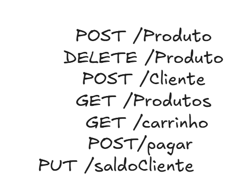

# Biblioteca

Sistema para a biblioteca controlar os empréstimos de livros: quem pegou, quando pegou e quando precisa devolver.

Projeto Final da disciplina de Backend (Engenharia de Software, SATC). **Etapa 1: arquitetura do backend.**

> **Este é o exemplo pronto da Etapa 1.** Mostra como fica um projeto entregue a partir do template: o problema e as regras criados pelo grupo, a estrutura de todas as entidades, a API funcionando com as regras implementadas e o README preenchido. Biblioteca não é um dos temas do sorteio.

## Índice

- [Integrantes](#integrantes)
- [O problema](#o-problema)
- [Tecnologias](#tecnologias)
- [Arquitetura](#arquitetura)
- [Entidades](#entidades)
- [Rotas](#rotas)
- [Como executar](#como-executar)
- [Situação do projeto](#situação-do-projeto)
- [Documentação](#documentação)

## Integrantes

| Nome | GitHub |
|---|---|
| Pedro Dal Ponte | @integrante1 |
| José Dos Santos | @integrante2 |
| Thales Vaz | @integrante3 |

## O problema

**Tema:** Revenda de midia fisicas de jogos

descrição : elaborar

**Quem usa o sistema:**

| Quem | O que faz no sistema |
|---|---|
| Dono E-Comerce | Cadastra midias fisicas, clientes e saldo |
| Cliente | Consulta os carrinho, midias e finalizar compra |

**Regras de negócio.** O grupo criou estas três regras olhando para o problema do caderno: hoje ninguém controla quantos livros cada leitor tem, nem se um exemplar já saiu, nem os prazos.

| # | Regra | Onde está no código | Rota que usa |
|---|---|---|---|
| R1 | Um cliente pode comprar somente produtos que tenham estoque > 0 | `compra.????` | `POST /pagar` |
| R2 | O dono não pode criar cadastro de midias com campos em branco | `??` | `POST /emprestimos` |
| R3 | O cliente compra midias somente com saldo >= preco | `??`| ?? |


**Elaborar integrações:** blablabla 

## Tecnologias

| O quê | Qual |
|---|---|
| Linguagem | Java 25 |
| Framework | Spring Boot 3.5 (Web, Validation, Data JPA) |
| Banco de dados | sqLite - Docker |
| Migrations | Flyway |
| Documentação da API | springdoc-openapi (Swagger UI) |

## Arquitetura

A API é organizada em camadas. Uma requisição entra pelo Controller, passa pelo Service, que aplica as regras de negócio, e chega ao banco pelo Repository; a resposta faz o caminho de volta. O Mapper converte DTO em entidade e entidade em DTO.

**Mapa da estrutura:**

| Entidade | Migration | Model | Repository | DTOs | Mapper | Service | Controller |
|---|---|---|---|---|---|---|---|
| Cliente | `V1__criar_livros.sql`, pronta | `Livro`, pronta | `LivroRepository`, pronto | `LivroRequestDTO`, `LivroResponseDTO`, prontos | `LivroMapper`, implementado | `LivroService`, implementado | `LivroController`, implementado |
| Produto | `V2__criar_leitores.sql`, pronta | `Leitor`, pronta | `LeitorRepository`, pronto | `LeitorRequestDTO`, `LeitorResponseDTO`, prontos | `LeitorMapper`, implementado | `LeitorService`, em parte: só o cadastro | `LeitorController`, em parte: só o `POST` |
| Carrinho | `V3__criar_emprestimos.sql`, pronta | `Emprestimo`, pronta | `EmprestimoRepository`, pronto | `EmprestimoRequestDTO`, `EmprestimoResponseDTO`, prontos | `EmprestimoMapper`, implementado | `EmprestimoService`, implementado (R1, R2 e R3) | `EmprestimoController`, implementado |

elaborar etc..

## Entidades

| Entidade | O que representa | Como se relaciona |
|---|---|---|
| Cliente | Um exemplar do acervo, que pode ser emprestado | Aparece em vários empréstimos |
| Comprar | Uma pessoa cadastrada na biblioteca | Faz vários empréstimos |
| Produto | A retirada de um livro por um leitor, com a data de devolução | Pertence a um leitor e a um livro |

Atributos, tipos e o diagrama das tabelas estão em [docs/modelo-de-dominio.md](docs/modelo-de-dominio.md).

## Rotas

### As que já funcionam

| Verbo | Caminho | O que faz | Regra | Sucesso | Erros |
|---|---|---|---|---|---|
| `POST` | `/livros` | Cadastra um livro | Nenhuma | `201` | `400` |
| `GET` | `/livros` | Lista os livros | Nenhuma | `200` | Nenhum |
| `GET` | `/livros/{id}` | Busca um livro pelo id | Nenhuma | `200` | `404` |
| `POST` | `/leitores` | Cadastra um leitor | Nenhuma | `201` | `400` |
| `POST` | `/emprestimos` | Registra um empréstimo e tira o livro da estante | R1, R2 e R3 | `201` | `400`, `404` |
| `PUT` | `/emprestimos/{id}/devolver` | Registra a devolução e devolve o livro à estante | R3 | `200` | `400`, `404` |



Exemplo de requisição:

```http
POST /emprestimos
Content-Type: application/json

{
  "leitorId": 1,
  "livroId": 1
}
```

Resposta, `201 Created`. Entram os ids; leitor e livro voltam completos, e a data limite já vem calculada pela regra R3:

```json
{
  "id": 1,
  "leitor": { "id": 1, "nome": "Ana Souza", "email": "ana@exemplo.com" },
  "livro": { "id": 1, "titulo": "Dom Casmurro", "isbn": "978-85-359-0277-5", "disponivel": false },
  "dataRetirada": "2026-10-06",
  "dataLimite": "2026-10-20",
  "dataDevolucao": null,
  "atrasado": false
}
```

### Erros

Todo erro sai no mesmo formato. Este é o `400` da regra R2, quando alguém tenta pegar um livro que já está emprestado:

```json
{
  "status": 400,
  "erro": "Bad Request",
  "mensagem": "R2: o livro 1 já está emprestado",
  "caminho": "/emprestimos",
  "timestamp": "2026-10-06T19:30:00",
  "campos": []
}
```

Um campo inválido também devolve `400`, com a lista `campos` dizendo qual campo corrigir. Um livro, leitor ou empréstimo que não existe devolve `404`.

### As planejadas

Estão no contrato, mas ainda não respondem.

| Recurso | O que vai fazer |
|---|---|
| `GET /leitores` e `GET /leitores/{id}` | Listar e buscar leitores |

O contrato completo, com todas as rotas e os DTOs, está em [docs/contrato-da-api.md](docs/contrato-da-api.md).

## Como executar

Pré-requisitos: JDK 25, Docker Desktop aberto e Git.

```bash
cd "Aula 10-11/exemplo-biblioteca"

docker compose up -d          # sobe o PostgreSQL na porta 5438
./mvnw spring-boot:run        # Windows: .\mvnw.cmd spring-boot:run
```

Com a API no ar:

| Endereço | O que é |
|---|---|
| <http://localhost:8080/swagger-ui.html> | Swagger UI: as rotas, com **Try it out** para enviar requisições |
| <http://localhost:8080/v3/api-docs> | O contrato OpenAPI em JSON |

Para testar as rotas, use o Swagger UI ou o **Postman**. No Postman, importe todas as rotas de uma vez: **Import** → **Link** → `http://localhost:8080/v3/api-docs`.

Para ver as regras funcionando: cadastre um livro e um leitor, faça um empréstimo e tente emprestar o mesmo livro de novo (R2). Depois cadastre mais livros e faça empréstimos para o mesmo leitor até o quarto ser barrado (R1).

Para parar: `Ctrl+C` na API e `docker compose stop` no banco. Para apagar o banco e rodar as migrations do zero: `docker compose down -v` e suba de novo.

## Situação do projeto

ReadME em andamento

| Parte | Situação |
|---|---|
| Desenho | Completo: problema e regras neste README, modelo e contrato em `docs/` |
| Estrutura | As 3 entidades têm migration, entidade, Repository, DTOs, Mapper, Service e Controller |
| API e regras | Livros com as 3 rotas da API simples; cadastro de leitores; empréstimo e devolução com R1, R2 e R3 implementadas |

**Ainda não funciona:** `GET /leitores` e `GET /leitores/{id}`.

## Documentação

| Documento | O que tem |
|---|---|
| [Modelo de domínio](docs/modelo-de-dominio.md) | Entidades, relacionamentos, diagrama das tabelas, migrations |
| [Contrato da API](docs/contrato-da-api.md) | Todas as rotas, os DTOs, exemplos de JSON e erros |
| [Autoavaliação](docs/autoavaliacao.md) | Os critérios da revisão do código, marcados pelo grupo |
