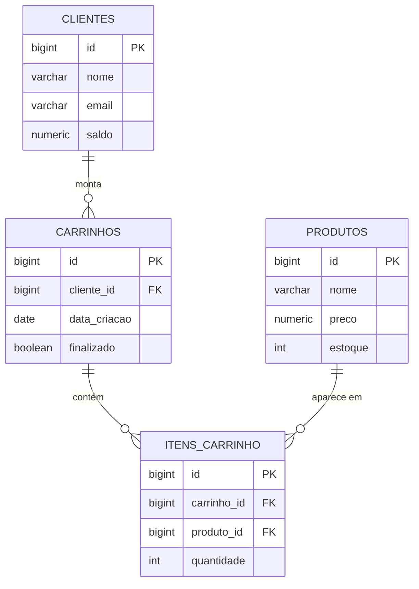

# Modelo de domínio

## Entidades

### Cliente

Pessoa cadastrada na loja, que tem saldo e monta carrinhos.

| Atributo | Tipo Java | Coluna | Obrigatório | Regra |
|---|---|---|---|---|
| `id` | `Long` | `id` | sim | Gerado pelo banco |
| `nome` | `String` | `nome` | sim | Até 255 caracteres |
| `email` | `String` | `email` | sim | Até 255 caracteres. Formato de e-mail válido |
| `saldo` | `BigDecimal` | `saldo` | sim | Nasce zerado; só aumenta pelo `PUT /saldo-cliente` e diminui na compra (R3). O cliente não envia no cadastro |

### Produto

Uma mídia física de jogo à venda, com preço e estoque.

| Atributo | Tipo Java | Coluna | Obrigatório | Regra |
|---|---|---|---|---|
| `id` | `Long` | `id` | sim | Gerado pelo banco |
| `nome` | `String` | `nome` | sim | Até 255 caracteres. Não pode ficar em branco (R2) |
| `preco` | `BigDecimal` | `preco` | sim | Maior que zero, até 2 casas decimais (R2) |
| `estoque` | `Integer` | `estoque` | sim | Zero ou mais (R2). Diminui na compra (R1) |

### Carrinho

Conjunto de produtos que um cliente pretende comprar. Depois da compra, fica finalizado.

| Atributo | Tipo Java | Coluna | Obrigatório | Regra |
|---|---|---|---|---|
| `id` | `Long` | `id` | sim | Gerado pelo banco |
| `cliente` | `Cliente` | `cliente_id` | sim | O cliente precisa existir |
| `dataCriacao` | `LocalDate` | `data_criacao` | sim | A API preenche com a data do dia |
| `finalizado` | `boolean` | `finalizado` | sim | Nasce `false`; vira `true` na compra. Carrinho finalizado não recebe itens nem é comprado de novo |

### ItemCarrinho

Um produto dentro de um carrinho, com a quantidade pedida.

| Atributo | Tipo Java | Coluna | Obrigatório | Regra |
|---|---|---|---|---|
| `id` | `Long` | `id` | sim | Gerado pelo banco |
| `carrinho` | `Carrinho` | `carrinho_id` | sim | O carrinho precisa existir e não estar finalizado |
| `produto` | `Produto` | `produto_id` | sim | O produto precisa existir e ter estoque suficiente (R1) |
| `quantidade` | `Integer` | `quantidade` | sim | Maior que zero. Repetir o produto no carrinho soma a quantidade |

O preço unitário e o subtotal que aparecem na resposta da API vêm do `Produto` (`preco` x `quantidade`); o total do carrinho é a soma dos subtotais.

## Relacionamentos

| De | Para | Tipo | No banco | No código |
|---|---|---|---|---|
| Carrinho | Cliente | muitos para um | `carrinhos.cliente_id` referencia `clientes(id)` | `@ManyToOne` em `Carrinho` |
| ItemCarrinho | Carrinho | muitos para um | `itens_carrinho.carrinho_id` referencia `carrinhos(id)` | `@ManyToOne` em `ItemCarrinho` |
| ItemCarrinho | Produto | muitos para um | `itens_carrinho.produto_id` referencia `produtos(id)` | `@ManyToOne` em `ItemCarrinho` |

Entre Carrinho e Produto a relação é muitos para muitos: um carrinho tem vários produtos e um produto aparece em vários carrinhos. A tabela `itens_carrinho` resolve isso e guarda a quantidade.

## Diagrama ER

Como ler: `||--o{` é "um para muitos". Um cliente monta zero ou vários carrinhos, e cada carrinho é de exatamente um cliente. Um carrinho tem zero ou vários itens, e cada item é de um carrinho e de um produto.

A compra não tem tabela própria: `POST /compra` finaliza o carrinho (`finalizado = true`), e os carrinhos finalizados de um cliente são o histórico das compras dele.

## Migrations

Todas existem em `src/main/resources/db/migration`.

| Versão | Arquivo | O que cria |
|---|---|---|
| V1 | `V1__criar_clientes.sql` | Tabela `clientes` |
| V2 | `V2__criar_produtos.sql` | Tabela `produtos` |
| V3 | `V3__criar_carrinhos.sql` | Tabelas `carrinhos` e `itens_carrinho`, com as chaves estrangeiras |
